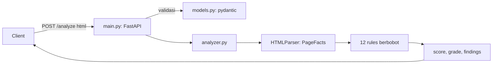

# Architecture

## Ringkasan
SEO Page Checker menerima HTML mentah lewat HTTP, mengekstrak fakta penting dari halaman dalam satu kali parsing,
lalu mengevaluasi serangkaian aturan berbobot untuk menghasilkan skor dan temuan.
Pengguna sasaran: konsultan SEO dan developer yang ingin mengecek kualitas on-page secara otomatis (misalnya di pipeline CI).

## Alur

## Modul
| File | Tanggung jawab |
|---|---|
| `app/config.py` | Membaca environment variable (`MAX_HTML_CHARS`, `LOG_LEVEL`) dan memvalidasinya saat start |
| `app/models.py` | Skema request/response; membatasi ukuran input |
| `app/analyzer.py` | `PageFacts` + `_FactsParser` (ekstraksi), `RULES` (aturan), `analyze_html` (orkestrasi) |
| `app/main.py` | Routing HTTP dan logging; tidak berisi logika bisnis |

## Keputusan teknis
| Keputusan | Alasan | Alternatif yang dipertimbangkan |
|---|---|---|
| FastAPI | Validasi input dan dokumentasi OpenAPI otomatis, cepat dibuat | Flask |
| `html.parser` bawaan | Nol dependency tambahan, toleran terhadap HTML rusak, cukup untuk kebutuhan ini | BeautifulSoup, lxml |
| Hanya menerima HTML (bukan URL) | Menghindari SSRF dan urusan jaringan; mudah dites | Fetch URL (masuk roadmap, butuh proteksi SSRF) |
| Fungsi murni di `analyzer.py` | Mudah di-unit-test tanpa server | Logika di route |
| Skor berbobot yang eksplisit | Transparan dan mudah dijelaskan; total bobot = 100 dan dijaga oleh test | Skor heuristik tersembunyi |
| Stateless, tanpa database | Sederhana dan mudah diskalakan | Menyimpan riwayat analisis |
| Docker non-root + HEALTHCHECK | Praktik dasar keamanan dan operasional | Menjalankan sebagai root |

## Menambah aturan
1. Tambahkan fakta yang dibutuhkan ke `PageFacts` dan isi di `_FactsParser` (bila perlu).
2. Tulis fungsi `_nama_rule(facts) -> (passed, message)` di `analyzer.py`.
3. Tambahkan `Rule(...)` ke `RULES`. Total bobot harus tetap 100 (ada test yang memeriksa ini), jadi sesuaikan bobot lain.
4. Tambahkan test untuk kasus lolos dan gagal di `tests/test_analyzer.py`.
5. Perbarui tabel aturan di `README.md` dan jumlah aturan di `tests/test_api.py`.

## Batasan dan risiko
- Ukuran input dibatasi (`MAX_HTML_CHARS`) untuk melindungi memori, namun belum ada rate limiting atau autentikasi.
- Parsing HTML besar bersifat CPU-bound dan berjalan di threadpool FastAPI; untuk beban tinggi pertimbangkan batas concurrency.
- Rentang ideal (title, description) adalah heuristik umum dan dapat diubah di konstanta `TITLE_RANGE`, `DESCRIPTION_RANGE`, `MIN_WORDS`.
